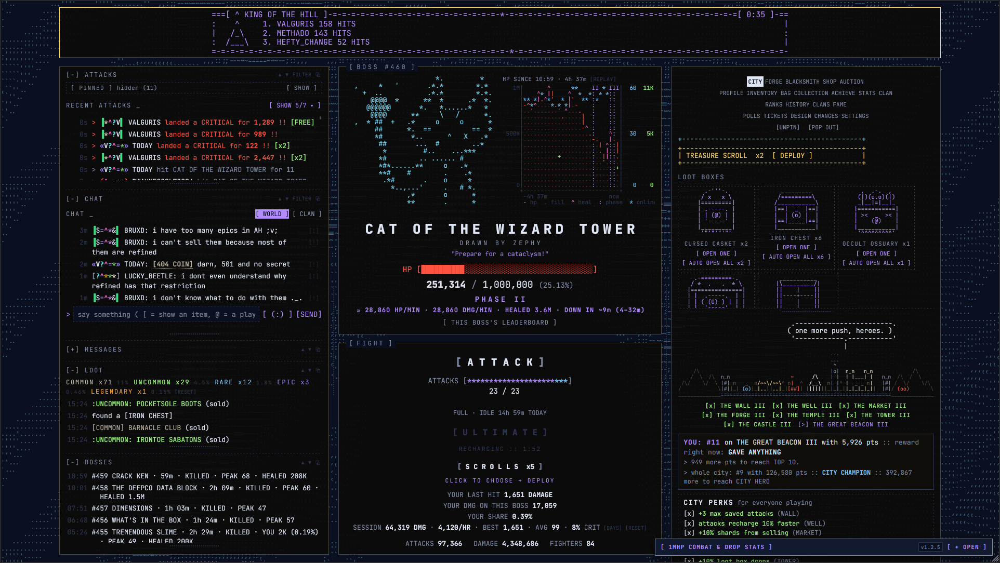

# OMHP Toolkit

A Tampermonkey userscript for [One Million HP](https://onemillionhp.com/). It adds a three-column layout with pinned and pop-out panels, a boss HP graph with a kill ETA and replay, session, loot and boss logs, alerts, chat and feed filters, saved layouts and colour themes. Almost everything can be switched off in its own settings menu, **[TOOLKIT]**.

[](docs/screenshot-hq.png)
<sub>Click for the full-size (4K) screenshot.</sub>

## Install

1. Install [Tampermonkey](https://www.tampermonkey.net/) (or another userscript manager such as Violentmonkey).
2. Open **[omhp-toolkit.user.js](https://raw.githubusercontent.com/switchlove/OMHP-Toolkit/main/omhp-toolkit.user.js)** and Tampermonkey will offer to install it. You can also install it from **[Greasy Fork](https://greasyfork.org/en/scripts/601490-omhp-toolkit)**.
3. Reload onemillionhp.com.

Tampermonkey checks this repo for updates on its own when the `@version` number goes up.

## Features

### Layout
- Three columns: feed/chat/messages | boss | side panels. Under 1300px wide, the left column moves below everything else.
- Left column with ATTACKS, CHAT, MESSAGES, LOOT and BOSSES sections. Each one collapses, moves up or down, pops out, and resizes by dragging its bottom edge.
- Drag the gaps between columns to resize them. Double-click any drag handle to reset it.
- The boss column and the right column stay pinned in view while you scroll.
- A flat tab bar in the right column: every unlocked tab is a button, with short labels and no dropdowns.
- **[PIN]** keeps the open panel above the others. Pin up to three, stacked, each with its own **[UNPIN]** and a line under it you can drag to resize it. **[POP OUT]** opens the open panel in a floating window.
- BAG's loot-box cards are smaller, so more fit across the right column, and they're in the same order as SHOP (**BOX ORDER** in FEATURES).
- CLAN's MEMBERS list folds away with **[-]** / **[+]** on its heading, and stays folded until you open it again.
- RANKS (every 30 seconds) and HISTORY (every minute) reload while they're on screen (open, pinned or popped out), instead of only when you open the tab.
- Floating windows can be dragged, resized, minimised and faded, and several can be open at once. They snap to the screen's edges and to each other while you drag (hold Shift to place one freely), and **TILE** (in [TOOLKIT] → LAYOUT) lays them all out in a grid.
- Hides clutter: the duplicate MESSAGES heading, the key hints and the footer (the site's error line stays).

### Boss
- An ASCII HP graph next to the boss art covering the boss's whole life since you first saw it, kept across reloads. It marks heals, phase changes, players online (`*`) and your own damage (`+`), with a scale on the right for those two, and hovering shows the values for that moment. Phase changes are drawn on top of everything but the HP line, and FOG periods are shaded with `~`. Click an entry in the legend under it to hide or show that part (fill, heals, phases, online, your damage, fog). **[ALL] [1H] [15M]** zoom in on the recent part of a long fight, and **[REPLAY]** plays the boss's history back from the start over 10 seconds.
- HP/min, everyone's DMG/min, HP healed and an estimated kill time from the last 5 minutes, with a range from what the last 1 and 15 minutes say, e.g. `DOWN IN ~39m (31–52m)`.
- **BOSSES**: a log of every boss you've seen (the last 100): how long it lasted while you watched, whether you saw it die, your damage and share, the most players online and HP healed. **[GRAPH]** opens a boss's HP graph in a window you can move, resize, zoom and replay (kept for the last 20 bosses).
- During the FOG event it uses the site's real data and never records the fake HP.

### Fight
- **YOUR SHARE**: your percentage of all the damage on this boss.
- **SESSION**, in its own box under FIGHT: your damage today, damage per hour (counting only the time the game was open), attacks, best and average hit, crit rate, shards earned and spent, shards per hour, and time played. It carries over when you reload and starts again at midnight or when you click **[RESET]**. **[DAYS]** shows your last 14 days: damage, damage per hour, hits, crit rate, idle time, shards and loot. Hover AVG HIT for the spread of your last 200 hits (smallest, median, 9 in 10, biggest).
- **FULL IN**: time until every attack slot has refilled. **IDLE** adds up how long today your attacks sat full, recharging nothing.
- **LOOT**: what you found today, counted by rarity, with drops per 100 attacks (hover for the last 30 days). Like SESSION, it carries over when you reload and has its own **[RESET]**. **[CHESTS]** shows what your box openings gave, per box, next to the site's stated odds (from single opens; OPEN ALL only reports how many were opened).

### Shortcuts and filters
- **Alt+1…9** picks a tab in the right column, **Alt+P** pins or unpins, **Alt+O** pops it out and **Alt+T** opens [TOOLKIT]. The site's own keys (attack, U, S, 1–3) are untouched.
- **FILTER** on the ATTACKS and CHAT headers: hide lines with any of some words or names, and highlight lines with others (your name, your clan…).
- **COMPACT** (off by default, in FEATURES): tighter lines and spacing everywhere.
- **HOVER CARDS**: pause over a player's name in ATTACKS or CHAT to see their place on this boss's board (it lists the top 10) and their damage in the last 5 minutes.
- **STATS THEME**: if Zephy's [1MHP Data Statistics](https://gist.github.com/Zephy-fm/7eab1928aee90a961d28b206a4acccd1) userscript is installed, its panel takes on the toolkit's theme, highlight colour and the site's rarity colours. [TOOLKIT] → ADD-ONS shows whether it was found.

### Alerts
- The browser tab's title shows the boss's HP and kill estimate after the site's attack count, e.g. `(3/5) [72% ~39m] ONE MILLION HP`, or `[FOG]` during FOG.
- **NOTIFY** (off until you turn it on in FEATURES): desktop notifications while the tab is in the background, for full attacks, a boss going down or a new one arriving, FOG starting or ending, new messages, and loot from a rarity you pick (**LOOT ALERT** in [TOOLKIT], LEGENDARY or better by default).

### Top bar
- **[TOOLKIT]**: the toolkit's settings menu.
  - **COLOUR** and **THEME**: a highlight colour, plus full themes (TERMINAL, MIDNIGHT, PHOSPHOR, PAPER), or **CUSTOM** with a colour picker for each of the theme's colours. **SHARE** copies your custom theme (and highlight colour) as a code such as `OMHP1-0b1020-121a30-dfe6f5-7f8aa6-2c3550-ffb000`, and **USE CODE** applies one.
  - **FEATURES**: switch any of the HP graph, ETA, share, session, FULL IN, loot, clock, flat tabs, account name, tab title, boss log, shortcuts, filters, compact mode, the stats theme, box order, hover cards or notifications on or off. Changes apply after a reload.
  - **LOOT ALERT**: the lowest rarity that gets a notification.
  - **KEYS**: a reminder of the Alt shortcuts.
  - **ADD-ONS**: other userscripts it found and themed (see STATS THEME).
  - **LAYOUT**: switch between layouts. **DEFAULT** puts everything back to how it started, **BOSS FOCUS** collapses the left column, **TILE** arranges the open pop-out windows, and **+ SAVE** stores your current layout (column sizes, section order and heights, pins and pop-out windows) under a name.
  - **BACKUP**: **EXPORT** downloads all your toolkit settings, layouts and stats as a file; **IMPORT** loads one, for example in another browser.
  - **STORAGE**: how much the toolkit keeps in your browser. **CLEAN UP** keeps only the last 5 boss graphs and 50 loot lines. If the browser's storage ever fills up, the toolkit does this by itself and shows **STORAGE FULL** in the ⚠ warning if that still isn't enough.
  - **HELP**: **COPY DEBUG** copies the toolkit's version, the site's version, your browser, which features are off and what couldn't start, to paste into a bug report. It has no stats or names in it.
  - Colours, themes, filters and graph settings changed in one tab apply in your other open tabs straight away.
- A warning such as **⚠ 2 OFF** appears if parts of the toolkit couldn't start, for example after a site update. Hover it to see which parts.
- Local time and how long the page has been open.
- The account button shows your badges and name.

Your layout, sizes, order, colours, feature choices, HP history, session and loot are saved in your browser's localStorage. With the game open in more than one tab, one tab records the HP history and loot and the others show what it saves, so nothing is counted twice.

## Notes

This is an unofficial fan-made script and isn't affiliated with One Million HP. It changes how the page looks on your own screen and reads data the page already has. The only requests it makes are the ones the site makes itself when you open RANKS or HISTORY, repeated while those panels are on screen. Everything it keeps stays in your browser.

## Development

The userscript is built from the files in `src/`; don't edit `omhp-toolkit.user.js` by hand.

- `src/header.js` holds the userscript header (including `@version`) and the feature notes. `src/style.css` is the stylesheet. Everything else is one part each: `core.js` and `lib.js` (shared helpers), then a file per feature (`graph.js`, `session.js`, `loot.js`, `menu.js`, ...).
- `build.js` joins them, in the order listed at its top, into one function so they share a scope, and writes `omhp-toolkit.user.js`. That file stays committed, because installs and updates point at it.
- `src/lib.js` has the helpers that don't touch the page (formatting, the tab title, SESSION's counting, the ETA, the graph's columns). `test/lib.test.js` tests them.

```sh
npm install      # once: the lint tools
npm run build    # write omhp-toolkit.user.js from src/
npm test         # the tests
npm run lint     # eslint on the built script, the build script and the tests
npm run check    # is the built script up to date, and does it parse?
```

## Releasing

1. Raise `@version` in `src/header.js`, then `npm run build`. Tampermonkey only updates installs when this number goes up, and CI fails any change to the script that doesn't raise it.
2. Update the README (and the feature notes in `src/header.js`) for anything new.
3. Run `npm test` and `npm run lint`.
4. Commit and push to `main`. CI checks that the built script matches `src/`, its syntax, the tests and lint, and the release workflow creates a `vX.Y` GitHub release with the script attached. No manual tagging is needed.

## License

[MIT](LICENSE)

---

<sub>AI disclosure: [Claude](https://claude.ai) was used to help with code review and testing.</sub>
